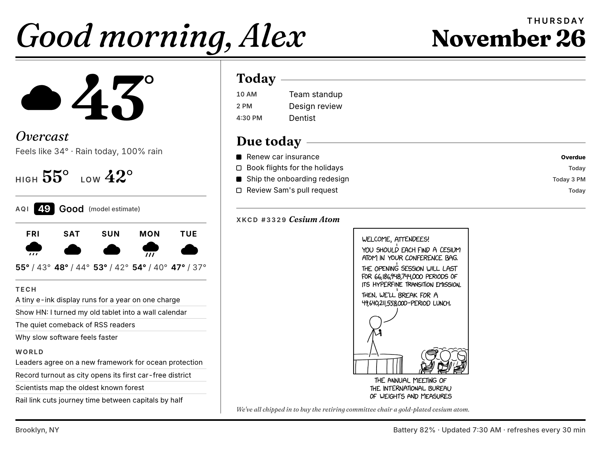
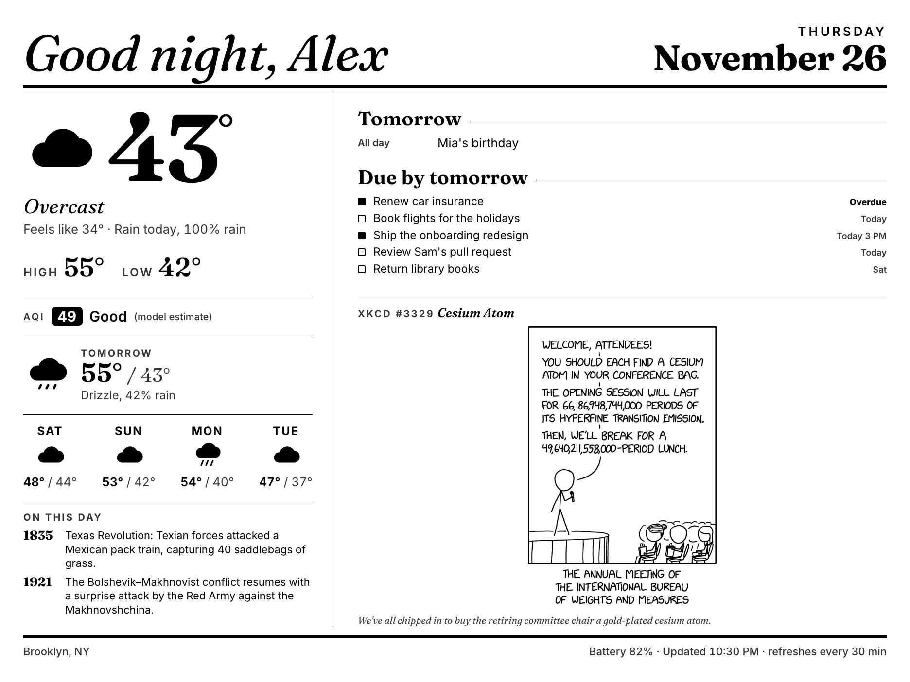
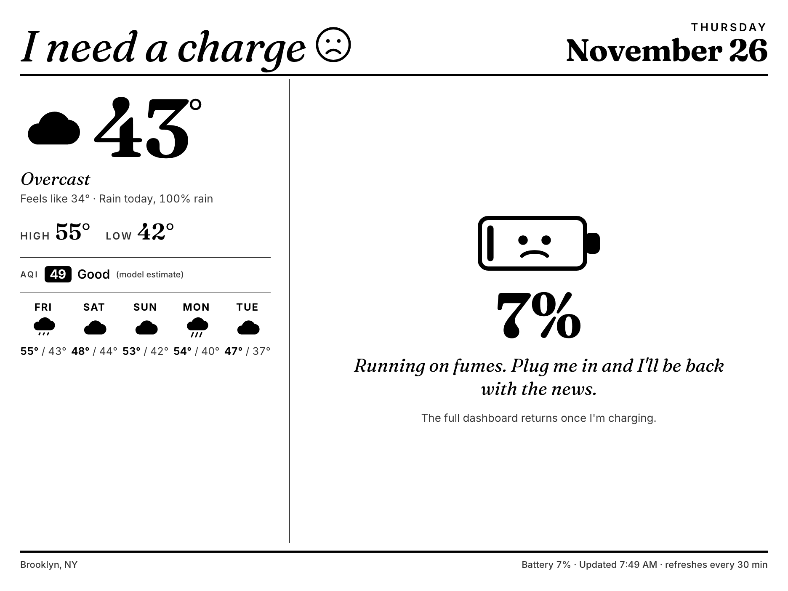

# rmdash: turn a reMarkable into an e-ink wall dashboard

Your old reMarkable becomes a calm, paper-like dashboard. It shows today's weather, air quality, your calendar,
your to-do lists and your team's next match. Your computer redraws it every 30 minutes. When the computer is off,
the last page stays on the screen, because e-ink needs no power to hold an image.


<sub>Rendered with `rmdash preview --demo` (sample data). On the tablet it's 16 shades of grey at 226 dpi.</sub>

### It changes through the day

| Morning (until 9:30) | Day | Night (from 9:30 PM) | Battery low |
|---|---|---|---|
|  |  |  |  |
| "Good morning, Alex", today's meetings, what's due, headlines, XKCD | Sports, calendar, to-dos, and "Today at a glance": next meeting countdown and day/week/year progress | "Good night", tomorrow's meetings, tasks and weather, On this day, XKCD | A sad battery asks to be plugged in |

The masthead also says "Good afternoon" and "Good evening" for one refresh when each begins, then goes back to your title.
All times are configurable under `[screens]`.

- **Doesn't change the tablet's system.** It uses the tablet's built-in SSH and puts one small program in `/home/root/rmdash`. No jailbreak, Toltec or system mods.
- **Reversible in one command.** `rmdash tablet restore`, or just a restart, brings back the normal reMarkable app with your notebooks untouched.
- **Free.** Every data source is free, and most don't need an account.
- **Runs on macOS, Windows and Linux.** It needs only Python (installed for you by `uv`). No system `ssh` is needed.
- **Easy to set up with an AI coding agent.** Point Claude Code, Codex, Cursor or similar at this repo and ask it to set things up ([see below](#option-a-let-a-coding-agent-set-it-up)).
- **Easy to restyle.** The whole design is one HTML/CSS file.

## What it can show

| Module | Source | Account / key |
|---|---|---|
| Weather: now, hourly, 5-day, sunrise/sunset | [Open-Meteo](https://open-meteo.com) | none |
| Air quality (AQI) | Open-Meteo model, or the nearest ground station via [WAQI](https://aqicn.org) | none / free token |
| Calendar: today and the next few days | Any iCal link: Google, iCloud, Outlook, public holidays | none |
| To-do lists, one column per list | [TickTick](https://ticktick.com) Open API (read-only) | free developer app |
| Next match, last result, league position | ESPN's public scores feed: football, NBA, NFL, MLB, NHL, college… | none |
| XKCD comic (morning and night) | [xkcd.com](https://xkcd.com) JSON | none |
| Headlines from any RSS/Atom feed (morning) | Hacker News, BBC, Google News for your country or a search | none |
| On this day (night) | Wikipedia / Wikimedia feed | none |
| Today at a glance: next meeting, task counts, day/week/year progress | Computed from your calendar and tasks | none |
| Tablet battery, and a "charge me" screen when low | Read from the tablet over SSH | none |
| Notes and a quote of the day | `notes.md` and `quotes.txt` in this folder | none |

Turn any of them on or off in `config.toml`. If a source is down, that section is skipped and the rest still renders.
More modules are planned; see [Roadmap](#roadmap).

## What you need

- A **reMarkable 1**. The reMarkable 2 draws its screen differently and isn't supported yet.
- A Mac, Windows or Linux computer that's on for at least part of the day.
- The tablet on the same Wi-Fi as the computer, or connected by a USB data cable.
- About 15 minutes.

## Quick start

### Option A: let a coding agent set it up

If you use Claude Code, Codex, Cursor, Copilot or a similar agent, clone the repo, open the folder in the agent, and paste:

> Set up rmdash for me. Read CLAUDE.md first and follow its setup playbook. My city is **___**. Ask me for the
> tablet's SSH password when you need it, store it only in `.env`, and show me a preview before you touch the tablet.

The agent installs the dependencies and creates your config. It walks you through finding the tablet password, pairs the
tablet, shows you a preview, and turns on the 30-minute refresh. [`CLAUDE.md`](CLAUDE.md) (also linked from
[`AGENTS.md`](AGENTS.md)) tells it how the project works and which tablet safety rules it must not break.

You can keep using the agent to customise things, for example: *"add my Google work calendar"*, *"follow Arsenal"*,
*"show my TickTick Work and Personal lists"*, *"call it The Smith Times"* or *"make the to-do text smaller"*.

### Option B: by hand

**1. Install [uv](https://docs.astral.sh/uv/getting-started/installation/)** (it installs the right Python for you):

```sh
# macOS / Linux
curl -LsSf https://astral.sh/uv/install.sh | sh
# Windows (PowerShell)
powershell -ExecutionPolicy ByPass -c "irm https://astral.sh/uv/install.ps1 | iex"
```

**2. Get the code and make a config:**

```sh
git clone https://github.com/OWNER/rmdash.git
cd rmdash
uv sync
uv run rmdash init --city "Lisbon"      # looks up your coordinates and writes config.toml
uv run rmdash preview                   # opens out/preview.png. The first run downloads a headless browser.
```

**3. Put the tablet password in `.env`.** See [Secrets and the `.env` file](#secrets-and-the-env-file) below.

**4. Pair the tablet and show the dashboard:**

```sh
uv run rmdash tablet setup        # installs an SSH key, backs up your notebooks, installs the display program
uv run rmdash push                # the dashboard appears on the tablet
uv run rmdash schedule install    # refresh every 30 min while this computer is on
```

That's it. To use the tablet as a notebook again, run `uv run rmdash tablet restore` (or restart the tablet).
The next scheduled refresh brings the dashboard back. To stop that, run `uv run rmdash schedule remove`.

## Secrets and the `.env` file

Passwords and tokens live in a file called `.env` in the project folder. It's listed in `.gitignore`, so git never
commits it. Settings that aren't secret (city, units, which modules) live in `config.toml`. That file is git-ignored too,
because calendar links are private.

**Create it** by copying the template, then filling in only what you use:

```sh
cp .env.example .env              # macOS / Linux
copy .env.example .env            # Windows (Command Prompt or PowerShell)
```

Open `.env` in any text editor. It's plain `NAME=value` lines:

```ini
RM_HOST=192.168.1.50      # the tablet: 10.11.99.1 over USB, or its Wi-Fi IP
RM_PASSWORD=aBcD1234      # Settings → Help → Copyrights and licenses, at the bottom
WAQI_TOKEN=               # optional
```

| Variable | What it is | Where to get it |
|---|---|---|
| `RM_HOST` | Tablet address | `10.11.99.1` over USB. For Wi-Fi: tablet Settings → Wi-Fi, or `rmdash tablet info` |
| `RM_USER` | SSH user | always `root` |
| `RM_PASSWORD` | Tablet SSH password | Tablet: **Settings → Help → Copyrights and licenses**, bottom of the page |
| `WAQI_TOKEN` | Ground-station air quality (optional) | [aqicn.org/data-platform/token](https://aqicn.org/data-platform/token/), free and emailed instantly |
| `TICKTICK_CLIENT_ID` / `_SECRET` | Your TickTick developer app (optional) | See [TickTick](#ticktick) |
| `TICKTICK_TOKEN` | Written for you by `rmdash ticktick login` | (automatic) |

Good habits:

- **Never commit `.env` or paste it into issues or chats.** If you share a screenshot for a bug report, use `rmdash preview --demo`.
- On macOS and Linux, run `chmod 600 .env` so only your user can read it (`rmdash ticktick login` does this for you).
- You can set any of these as environment variables instead. That's handy for CI or a home server.
- After `rmdash tablet setup` the tablet trusts an SSH key (`~/.ssh/remarkable_dashboard`), and the password is only a fallback.
  A reMarkable software update can reset the password. If pushes start failing, check the password on the tablet again.

## Setting up each module

### Weather and air quality

These work out of the box from `[location]` in `config.toml` (`rmdash init --city` fills it in). Choose units under `[units]`.
The AQI comes from a model. It's usually fine, but it can read low in cities with heavy local pollution. For the
reading from your nearest real monitoring station, add a free `WAQI_TOKEN` to `.env`. The station's name then
appears next to the AQI.

### Calendar

Add one or more iCal links to `config.toml`:

```toml
[calendar]
ics_urls = [
  "https://calendar.google.com/calendar/ical/you%40gmail.com/private-abc123/basic.ics",
]
days_ahead = 3
```

- **Google Calendar** (works for Workspace/work accounts too): on a computer, open Google Calendar → ⚙ Settings →
  click your calendar under *Settings for my calendars* → *Integrate calendar* → copy **Secret address in iCal format**.
  If a work account doesn't show that field, your admin has turned it off.
- **iCloud:** Calendar app → right-click the calendar → *Share Calendar* → tick *Public Calendar* → copy the `webcal://` link.
- **Outlook / Microsoft 365:** Outlook on the web → Settings → Calendar → *Shared calendars* → *Publish a calendar* → copy the ICS link.
- **Public holidays:** Google publishes one per country. For India it's
  `https://calendar.google.com/calendar/ical/en.indian%23holiday%40group.v.calendar.google.com/public/basic.ics`.
  For another country, swap `en.indian` for `en.usa`, `en.uk`, `en.german` and so on.

A secret iCal link gives read access to anyone who has it, so keep it out of git (it is, in `config.toml`). If one
leaks, reset it from the same settings page. Meetings that have already ended drop off the dashboard.

### TickTick

This is a one-time setup, about 3 minutes. It uses TickTick's official API with **read-only** access.

1. Go to [developer.ticktick.com](https://developer.ticktick.com), sign in, open **Manage Apps** and click **+ App Name** (call it anything).
2. Edit the app and set **OAuth redirect URL** to exactly `http://127.0.0.1:8765/callback`, then save.
3. Copy the app's **Client ID** and **Client Secret** into `.env` as `TICKTICK_CLIENT_ID=` and `TICKTICK_CLIENT_SECRET=`.
4. Run `uv run rmdash ticktick login`. A browser opens: approve, and the token is saved to `.env`.
5. In `config.toml`, set `enabled = true` and pick lists by their exact names:

```toml
[ticktick]
enabled = true
lists = ["Work", "Personal"]   # each list becomes a column; [] = every list
max_items = 8
```

Only unfinished tasks are shown. They're sorted by due date, then priority. High-priority tasks get a filled checkbox,
and overdue ones are marked. Something you tick off disappears at the next refresh.

### Sports

Any team on ESPN works: football (soccer), NBA, WNBA, NFL, MLB, NHL, college sports, MLS and more. Search by name, then
paste the block it prints into `config.toml`:

```sh
uv run rmdash sports search "barcelona"
```

```toml
[[sports]]
name = "Barça"        # shown on the dashboard, so shorten it if you like
sport = "soccer"
league = "esp.1"
team_id = 83
```

The strip shows the next fixture (all competitions for football clubs), the last result and the league position.
Repeat the block to follow more teams. Cricket isn't covered by ESPN's feed yet; it's on the roadmap.

### Timed screens, greetings and battery

```toml
[dashboard]
name = "Alex"              # "Good morning, Alex"

[screens]
morning = "05:00-09:30"    # "HH:MM-HH:MM", may wrap past midnight; "" turns a screen off
night = "21:30-05:00"
greet = true               # "Good afternoon/evening" for one refresh at 12:00 and 17:00

[battery]
low = 10                   # at or below this, and not charging, show the "I need a charge" screen

[headlines]
per_feed = 4
feeds = [
  { name = "Tech", url = "https://hnrss.org/frontpage?points=50" },
  { name = "India", url = "https://news.google.com/rss?hl=en-IN&gl=IN&ceid=IN:en" },
]
```

Preview any screen without waiting for the clock: `rmdash preview --at 07:30`, `--at 22:30` or `--battery 7`.

### Showing it off without showing your life

`rmdash preview --demo` and `rmdash push --demo` use a made-up city, calendar, to-do lists and fixture. Use them for screenshots, photos and bug reports.
Combine them with `--at` and `--battery` to put each screen on the tablet in turn:

```sh
uv run rmdash push --demo --at 07:30      # morning
uv run rmdash push --demo --at 11:00      # day
uv run rmdash push --demo --at 22:30      # night
uv run rmdash push --demo --battery 7     # low battery
uv run rmdash push                        # back to your real dashboard
```

The next scheduled refresh also brings your real dashboard back.

### Title, notes and quotes

- `title` under `[dashboard]` sets the masthead. *The Smith Times*, *Daily Planet*, *Casa Gomez*: make it yours.
- `notes.md`: one line per item, shown as a list. Edit it any time and it appears at the next refresh.
- `quotes.txt`: `quote | author` per line. One is picked per day, and it's hidden automatically when the page is full.

## Automatic refresh

`rmdash schedule install` uses whatever your computer has built in:

| OS | How | Notes |
|---|---|---|
| macOS | LaunchAgent `com.rmdash.refresh` | Runs at login and every N minutes, and catches up after sleep. **If the folder is in Documents, Desktop or Downloads**, macOS asks once whether Python can access that folder. Click **Allow**, or the refresh waits forever. |
| Windows | Task Scheduler (`rmdash-refresh` and `rmdash-refresh-logon`) | Runs every N minutes and at logon, with no console window. |
| Linux | Prints a `crontab` line to add | |

Change the interval with `minutes` under `[schedule]`, then run `schedule install` again. If the tablet is asleep, out of
Wi-Fi range or the computer is off, the run is skipped quietly and the next one catches up. Logs are in `logs/rmdash.log` on macOS and Linux.

## Everyday commands

All commands are `uv run rmdash …`, run from the project folder.

| Command | What it does |
|---|---|
| `preview` | Render to `out/preview.png` without touching the tablet |
| `preview --demo` | Render with sample data (good for screenshots and bug reports) |
| `preview --at 07:30` / `--battery 7` | Preview the morning, night or low-battery screen |
| `push --demo` | Show the sample dashboard on the tablet (for photos) |
| `push` | Update the tablet now |
| `tablet info` | Model, firmware, battery, Wi-Fi IP |
| `tablet restore` | Bring the normal reMarkable app back |
| `tablet backup` | Copy your notebooks to `backup/` |
| `tablet uninstall` | Remove everything rmdash put on the tablet |
| `sports search "team"` | Find a team to follow |
| `ticktick login` | Connect TickTick |
| `schedule install` / `remove` / `status` | Automatic refresh |

## Changing the design

Everything you see is [`rmdash/templates/dashboard.html`](rmdash/templates/dashboard.html): plain HTML and CSS with
[Jinja2](https://jinja.palletsprojects.com) tags. Edit it, run `rmdash preview`, and repeat. Some tips for e-ink:

- Keep body text pure black, and use greys only for labels and rules. The panel has 16 shades of grey and no colour.
- Fonts are bundled (Fraunces and Inter), so it renders the same on every computer.
- The page is 1872×1404 in landscape. If a column overflows, the template drops the quote first and then trims the longest to-do list.

## Troubleshooting

| Problem | Fix |
|---|---|
| `Cannot reach the tablet` | It may be asleep: commands wait for its next wake-up (on the hour and half hour). Otherwise wake the tablet (press the power button) and check it's on the same Wi-Fi. Check the IP with `rmdash tablet info` over USB, or in the tablet's Wi-Fi settings, and update `RM_HOST`. Many routers let you reserve a fixed IP for it. |
| USB: `10.11.99.1` doesn't respond | Use a cable that carries data (many only charge), plug in directly rather than through a hub, and unlock the tablet. Wi-Fi is usually easier. |
| Authentication failed | Check the password on the tablet again; software updates can change it. Then run `rmdash tablet setup`. |
| Dashboard is upside down | Switch `rotate` between `90` and `270`. |
| macOS: refreshes stopped | Look for a hidden "would like to access Documents" prompt, or move the folder out of Documents and run `schedule install` again. |
| A section is missing | The footer lists any source that failed. Run `rmdash preview` in a terminal to see the warnings. |
| `TickTick … redirect_uri` error | The redirect URL in your TickTick app must be exactly `http://127.0.0.1:8765/callback`. |
| I want my notebooks back | Run `rmdash tablet restore`, or restart the tablet. Your notebooks never left. |

## FAQ

**Can it break my tablet?** rmdash writes only inside `/home/root/rmdash` and adds one line to
`~/.ssh/authorized_keys`. It never touches the system partition, the bootloader or your notebooks, and `tablet setup`
backs up your notebooks first. Showing the dashboard just stops the reMarkable app until you restore it or restart.
reMarkable software updates don't affect it, but an update can reset the SSH password.

**Does it drain the battery?** Not much. Between refreshes the tablet goes into deep sleep. It wakes on the hour and
half hour, stays awake about 3 minutes so your computer can push the new page, then sleeps again. E-ink keeps showing
the page the whole time. The footer shows the battery level, and a "charge me" screen appears below 10%. You can turn
sleeping off with `sleep = false` under `[tablet]`. It then stays awake (and reachable) all the time, but lasts hours rather than days.

**The tablet is asleep. How do I reach it?** Any `rmdash` command that needs the tablet waits for its next wake-up
(at most one refresh interval) and tells you when that is. Restarting the tablet (hold the power button, then turn it on)
always brings back the normal reMarkable app, because the sleep loop doesn't survive a reboot.

**Do I need to leave the tablet connected to my computer?** No. Over Wi-Fi, the computer only needs to be on and on the
same network when a refresh happens.

**Is there a better way than sending an image?** Rendering on the computer keeps the tablet untouched and makes the
design just a web page. The alternative is running an app on the tablet itself, which means installing system
mods and redoing them after every reMarkable update. That's how projects like
[trmnl-remarkable](https://github.com/usetrmnl/trmnl-remarkable) work. A "pull" mode, where the tablet fetches the image
on its own and sleeps in between, is on the roadmap for setups without a computer that's always on.

**reMarkable 2 / Paper Pro?** Not yet. They need a different screen driver. PRs welcome.

## How it works

```
your computer (every 30 min)                                         reMarkable (/home/root/rmdash)
 data.py ──► dashboard.html ──► headless Chromium ──► 16-grey PNG ──SSH──► rmdash-show ──► e-ink panel
 weather, AQI, calendar,          (Jinja2)            1404×1872              writes /dev/fb0 and asks for
 tasks, sports, notes                                                         a full refresh
```

1. `rmdash/data.py` gathers everything. Each source fails on its own without breaking the page.
2. The template is rendered and screenshotted by Playwright's headless Chromium at the panel's exact resolution, then
   rotated and snapped to the panel's 16 grey levels.
3. The PNG is uploaded over SSH ([paramiko](https://www.paramiko.org), so no system `ssh` is needed) and written atomically.
4. On the tablet, `rmdash-show`, a 1.8 MB static Go program ([source](device/main.go)), stops the reMarkable app so it
   doesn't draw over the dashboard. It then writes the image to the framebuffer and triggers a full e-ink refresh.
5. A small [sleep loop](rmdash/bin/sleep-loop.sh) runs as a temporary systemd unit. It puts the tablet into deep sleep
   with a wake-up alarm set for the next refresh, so the tablet lasts days instead of hours. The scheduled job on your
   computer runs at the same times (:00, :30), waits for the tablet to come online, and keeps it awake until the push is done.

## Roadmap

Planned (all free): cricket fixtures, F1, a holiday and birthday countdown, moon phase and UV, currency rates,
headlines and Hacker News, Wikipedia's "On this day", art or NASA picture of the day dithered for e-ink, a Wi-Fi guest
QR code, and tablet battery in the footer. There will also be a portrait layout, a **point-and-click setup page** so
nobody needs a terminal, and a pull mode for tablets away from a computer (the tablet would fetch the page itself). Ideas and PRs are welcome. See
[CONTRIBUTING.md](CONTRIBUTING.md).

## Credits and license

MIT, see [LICENSE](LICENSE). The fonts are Fraunces and Inter (SIL Open Font License). Weather and air quality data
come from [Open-Meteo](https://open-meteo.com) (CC BY 4.0), station AQI from the [World Air Quality Index project](https://aqicn.org),
and sports from ESPN's public feed (unofficial; it could change without notice). This is a community project and is not
affiliated with reMarkable AS, TickTick or ESPN.
