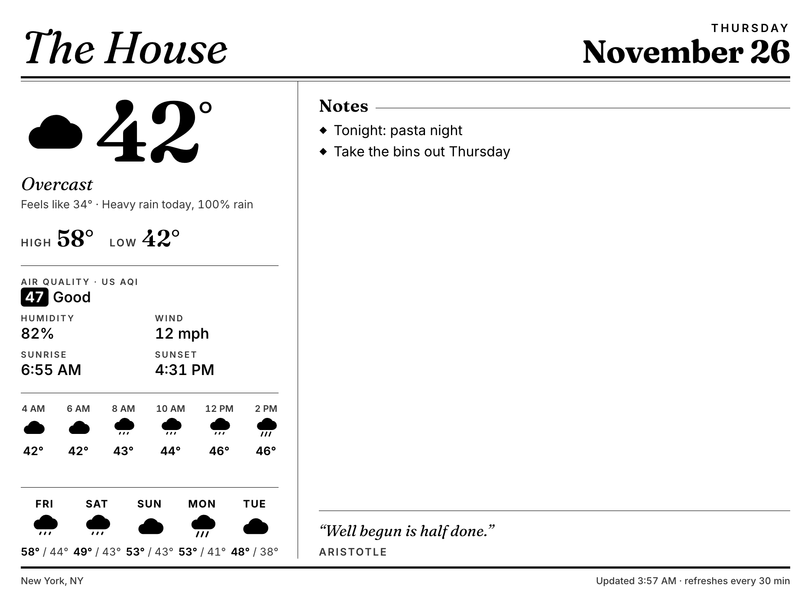

# rmdash: a reMarkable home dashboard

Turn an old reMarkable tablet into an e-ink wall dashboard showing weather, air quality,
your calendar, notes and a daily quote. Your computer renders the page and pushes it to the tablet every 30 minutes.
When the computer is off, the last dashboard simply stays on the screen.



- **No jailbreak or system mods.** It uses the tablet's built-in SSH and one small program in `/home/root/rmdash`.
- **Reversible.** `rmdash tablet restore` (or a reboot) brings back the normal reMarkable interface.
- **macOS, Windows and Linux.** Pure Python and Go, with no system `ssh` needed.
- **Free data.** Weather and air quality come from [Open-Meteo](https://open-meteo.com) (no API key). Calendars come from any iCal link.
- **Easy to redesign.** The dashboard is one HTML/CSS file: `rmdash/templates/dashboard.html`.

Tested on: reMarkable 1. The reMarkable 2 needs a different screen driver and isn't supported yet.

## Setup

You need [uv](https://docs.astral.sh/uv/) (it installs Python for you) and a USB cable that carries data.

```sh
git clone <this repo> && cd rmdash
uv sync
uv run rmdash init --city "Your City"   # creates config.toml
uv run rmdash preview                   # see it before touching the tablet
```

Connect the tablet:

1. Plug it into the computer **directly** (not through a hub) and wake it.
2. On the tablet, open **Settings → Help → Copyrights and licenses**. The SSH password is at the bottom.
3. Create a `.env` file in this folder (it's git-ignored):
   ```
   RM_HOST=10.11.99.1
   RM_PASSWORD=the-password-from-step-2
   ```
4. Then run:
   ```sh
   uv run rmdash tablet setup      # installs an SSH key, backs up your notebooks, installs the display program
   uv run rmdash push              # the dashboard appears
   uv run rmdash schedule install  # refresh every 30 min while this computer is on
   ```

To go wireless, run `uv run rmdash tablet info` to get the Wi-Fi IP, then set `host` under `[tablet]` in config.toml.

Using a coding agent? Point it at this repo and say "set up rmdash for me". [CLAUDE.md](CLAUDE.md) has everything it needs.

## Everyday use

| | |
|---|---|
| `rmdash preview` | Render `out/preview.png` without touching the tablet |
| `rmdash push` | Update the tablet now |
| `rmdash tablet restore` | Get the normal reMarkable UI back |
| `rmdash tablet info` | Model, firmware, battery, Wi-Fi IP |
| `rmdash tablet backup` | Save your notebooks to `backup/` |
| `rmdash tablet uninstall` | Remove everything from the tablet |
| `rmdash schedule remove` | Stop automatic refreshes |

Edit `notes.md` for the Notes list and `quotes.txt` for the quotes. Add Google or iCloud calendar iCal links in `config.toml`.

## How it works

The computer gathers data (`rmdash/data.py`), fills in the HTML template, and screenshots it with headless Chromium
at the panel's exact 1404×1872 resolution. It snaps the image to the panel's 16 greys and uploads it over SSH.
On the tablet, `rmdash-show` (source in `device/`) stops the normal UI so it doesn't draw over the dashboard,
writes the image to the framebuffer, and asks the e-ink controller for a full refresh.

## Safety

The only things written to the tablet are `/home/root/rmdash/` and one line in `~/.ssh/authorized_keys`.
The tablet's system files are never modified. Setup backs up your notebooks first.
reMarkable has a USB recovery mode, so even a bad experiment is recoverable.
This is a community project, not affiliated with reMarkable.

## License

MIT. Fonts: Fraunces and Inter, SIL Open Font License (see `rmdash/fonts`).
